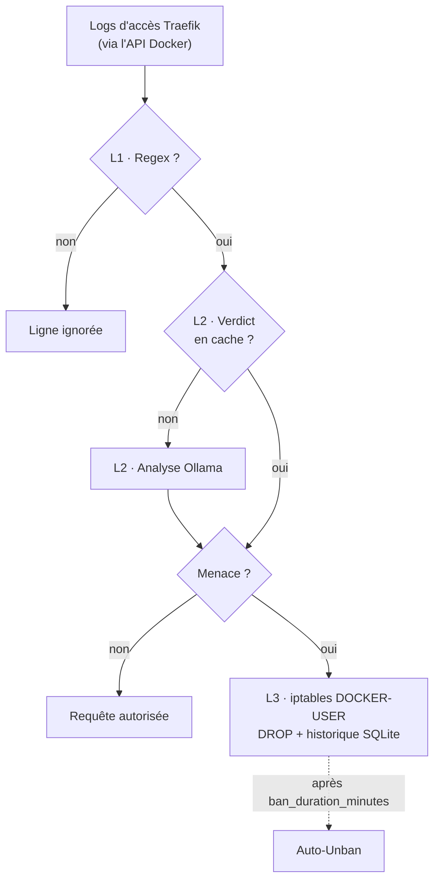

# 🛡️ Sentinel-Zero

> **Agent SRE / DevSecOps autonome en Go.** Il suit les logs d'un reverse proxy Docker, détecte les attaques web en temps réel, bannit les IP malveillantes au niveau noyau (iptables) et expose une API de contrôle.


## Sommaire

- [Présentation](#présentation)
- [Fonctionnalités](#fonctionnalités)
- [Fonctionnement](#fonctionnement)
- [Prérequis](#prérequis)
- [Installation](#installation)
- [Configuration](#configuration)
- [Utilisation](#utilisation)
- [Environnement de test](#environnement-de-test)
- [Sécurité et limites](#sécurité-et-limites)
- [Contenu du dépôt](#contenu-du-dépôt)

## Présentation

Sentinel-Zero tourne en service systemd sur un hôte Docker. Il suit en continu les logs d'accès d'un conteneur cible (typiquement **Traefik**), repère les requêtes d'attaque (injection SQL, injection de commandes, path traversal), fait trancher un **LLM local (Ollama)** sur les cas suspects, puis bloque l'IP source avec **iptables**. Le ban est levé automatiquement après une durée configurable.

L'agent s'organise en trois couches :

| Couche | Rôle |
|---|---|
| **L1 — Détection** | Regex appliquée à chaque ligne de log. |
| **L2 — Analyse IA** | Cache SHA-256, puis verdict du LLM (Ollama). |
| **L3 — Remédiation** | Règle `DROP` dans la chaîne iptables `DOCKER-USER`, avec Auto-Unban. |

Par défaut, l'analyse IA reste 100 % locale (Ollama sur `localhost`).

## Fonctionnalités

- **Multi-Tenancy :** configuration dynamique par client via un fichier JSON.
- **Détection L1 :** regex configurable appliquée en continu aux logs du conteneur ciblé.
- **Analyse IA L2 :** verdict `MENACE` / `SAIN` rendu par un LLM local (`llama3.2` par défaut).
- **Cache sémantique (SHA-256) :** déduplication des requêtes IA ; une attaque déjà vue est tranchée sans rappeler le modèle (latence quasi nulle).
- **Remédiation L3 :** frappe noyau dynamique (iptables, chaîne `DOCKER-USER`) avec Auto-Unban (TTL).
- **Historique :** chaque blocage est enregistré dans une base SQLite.
- **API de contrôle :** `/api/metrics` (statistiques et derniers événements) et `/api/unban`, protégées par une clé d'API.
- **Liste blanche :** les IP de confiance ne sont jamais bannies.
- **Service systemd :** démarrage automatique et redémarrage en cas de crash.

## Fonctionnement



1. **Collecte :** l'agent suit les logs (stdout et stderr) du conteneur `target_container` via l'API Docker. Seules les nouvelles lignes sont analysées. Il attend le format d'access log par défaut de Traefik (CLF) : la première colonne est l'IP du client, la requête HTTP est entre guillemets.
2. **L1 — Regex :** chaque ligne est testée avec `regex_pattern`. Les IP de `whitelisted_ips` sont ignorées.
3. **L2 — Cache :** la requête HTTP (texte entre les premiers guillemets de la ligne) est hachée en SHA-256. Si un verdict existe déjà, il est appliqué sans appeler le LLM.
4. **L2 — LLM :** sinon, Ollama reçoit la requête (température 0, 5 tokens maximum) et doit répondre `MENACE` ou `SAIN`. Le verdict est mis en cache.
5. **Fail-closed :** si Ollama est injoignable ou ne répond pas en **1 seconde**, la requête est jugée malveillante (moteur `Heuristique L2`). Une réponse vide, ou sans le mot `SAIN`, est aussi traitée comme une menace.
6. **L3 — Ban :** `iptables -I DOCKER-USER 1 -s <ip> -j DROP`, l'événement est enregistré dans SQLite et le ban expire après `ban_duration_minutes`.

## Prérequis

| Composant | Remarque |
|---|---|
| Linux + systemd | accès root ; `iptables` dans le `PATH` |
| Docker Engine | fournit la chaîne `DOCKER-USER` ; le service dépend de `docker.service` |
| Docker Compose v2 | uniquement pour l'[environnement de test](#environnement-de-test) |
| Go 1.26 ou supérieur | compilation de l'agent |
| Compilateur C (gcc) | requis par `go-sqlite3` (CGO) |
| [Ollama](https://ollama.com) | avec le modèle configuré, par ex. `ollama pull llama3.2` |

## Installation

```bash
git clone https://github.com/snisharahamad/sentinel-zero.git
cd sentinel-zero

# 1. Compiler et installer l'agent (CGO requis pour go-sqlite3)
#    Debian/Ubuntu : sudo apt install build-essential
(cd agent-go && CGO_ENABLED=1 go build -o sentinel-agent .)
sudo install -m 0755 agent-go/sentinel-agent /usr/local/bin/sentinel-agent

# 2. Créer la configuration (voir la section Configuration)
sudo mkdir -p /etc/sentinel /var/lib/sentinel
sudo cp config_example.json /etc/sentinel/config.json
sudo nano /etc/sentinel/config.json      # renseigner api_key et db_path
sudo chmod 600 /etc/sentinel/config.json

# 3. Installer et démarrer le service systemd
sudo cp sentinel.service /etc/systemd/system/sentinel.service
sudo systemctl daemon-reload
sudo systemctl enable --now sentinel
```

## Configuration

L'agent lit sa configuration dans **`/etc/sentinel/config.json`** (chemin fixe). Un fichier par client (Multi-Tenancy).

```json
{
  "client_name": "NOM_DU_CLIENT",
  "target_container": "traefik-proxy",
  "ollama_url": "http://localhost:11434/api/generate",
  "llm_model": "llama3.2",
  "discord_webhook": "URL_WEBHOOK_ICI",
  "ban_duration_minutes": 60,
  "metrics_port": "127.0.0.1:9090",
  "api_key": "GENERER_UNE_CLE_LONGUE_ET_ALEATOIRE",
  "db_path": "/var/lib/sentinel/sentinel.db",
  "whitelisted_ips": ["127.0.0.1"],
  "regex_pattern": "(?i)(union\\s+select|[;&|]|%3B|%26|%7C)\\s*(id|whoami|wget|curl|cat)|(\\/|%2F)etc(\\/|%2F)passwd|(\\.\\.%2F|\\.\\.\\/)"
}
```

| Clé | Description |
|---|---|
| `client_name` | Nom du client (tenant), repris dans les logs et dans la réponse de `/api/metrics`. |
| `target_container` | Conteneur Docker dont les logs sont analysés (ex. `traefik-proxy`). |
| `ollama_url` | Endpoint `generate` de l'API Ollama. |
| `llm_model` | Modèle Ollama utilisé pour classer les requêtes. |
| `discord_webhook` | Réservé : non utilisé par cette version de l'agent. |
| `ban_duration_minutes` | Durée d'un ban, en minutes (`0` = pas d'expiration automatique). |
| `metrics_port` | Adresse d'écoute (`hôte:port`) de l'API de contrôle. |
| `api_key` | Clé d'accès à l'API de contrôle. **Obligatoire et non vide.** |
| `db_path` | Chemin du fichier SQLite (historique des événements). Le dossier doit exister. |
| `whitelisted_ips` | IP qui ne sont jamais bannies. |
| `regex_pattern` | Regex (syntaxe Go) appliquée à chaque ligne de log. |

> ⚠️ **`api_key` ne doit jamais être vide.** Avec une clé vide ou absente du JSON, l'API de contrôle accepte les requêtes sans jeton. Générez-en une avec `openssl rand -hex 32`.

> **À savoir :** dans le JSON, chaque `\` de la regex doit être doublé (`\\s`). Le motif d'exemple est large et s'applique à la ligne de log entière : une requête légitime contenant `&id=` ou `&cat=` dans son URL peut correspondre. Testez-le sur votre trafic réel.

## Utilisation

```bash
sudo systemctl status sentinel         # état du service
sudo journalctl -u sentinel -f         # logs en direct
sudo iptables -L DOCKER-USER -n        # IP actuellement bannies
sudo systemctl restart sentinel        # après une modification de la config
```

Repères dans les logs : `[L1 REGEX]` (ligne suspecte), `[CACHE HIT L2]` (verdict en cache), `[FALLBACK L2]` (Ollama indisponible), `[L3 BAN]` et `[UNBAN]`.

### API de contrôle

L'API écoute sur `metrics_port` et exige la clé d'API dans l'en-tête `Authorization`.

```bash
KEY="votre_api_key"

# Statistiques et 50 derniers événements
curl -H "Authorization: Bearer $KEY" http://127.0.0.1:9090/api/metrics

# Débannir une IP manuellement
curl -H "Authorization: Bearer $KEY" "http://127.0.0.1:9090/api/unban?ip=203.0.113.7"
```

Exemple de réponse de `/api/metrics` (valeurs fictives) :

```json
{
  "client": "NOM_DU_CLIENT",
  "status": "OPERATIONAL",
  "metrics": {
    "logs_processed": 1240,
    "regex_hits": 3,
    "cache_hits": 1,
    "llm_calls": 2,
    "active_bans": 1
  },
  "events": [
    {
      "id": 1,
      "timestamp": "2026-11-17T21:04:12Z",
      "ip": "203.0.113.7",
      "uri": "GET /ping?ip=127.0.0.1;id HTTP/1.1",
      "engine": "Llama 3.2",
      "active": true
    }
  ]
}
```

- `logs_processed` : lignes lues · `regex_hits` : lignes suspectes (L1) · `cache_hits` : verdicts servis par le cache · `llm_calls` : requêtes envoyées à Ollama · `active_bans` : bans en cours.
- `engine` indique qui a tranché : `Llama 3.2`, `Cache SHA-256` ou `Heuristique L2` (Ollama indisponible ou trop lent).

## Environnement de test

Le fichier `docker-compose.yml` monte un petit lab sur le réseau `sentinel-net` :

| Service | Rôle |
|---|---|
| `traefik` (`traefik-proxy`) | Reverse proxy Traefik v2.11, access logs activés, ports 80 et 8080. C'est le conteneur surveillé par l'agent. |
| `vulnerable-api` | Application Flask `target/server.py` servie par gunicorn, routée par Traefik sur `api.sentinel.local`. |

```bash
docker compose up -d
```

Au premier démarrage, `vulnerable-api` installe Flask et gunicorn (accès Internet requis).

> ⚠️ **Lab uniquement.** `server.py` est volontairement vulnérable (injection de commandes via `os.popen`, XSS réfléchi) et le dashboard Traefik est ouvert sans authentification (`--api.insecure=true`, port 8080). Ne l'exposez jamais sur Internet.

Pour déclencher une détection, faites pointer le nom du lab vers l'hôte depuis **une autre machine** (depuis l'hôte lui-même, Traefik voit généralement l'IP de la passerelle Docker plutôt que `127.0.0.1`, et vous ne verrez pas de vrai blocage) :

```bash
echo "IP_DU_LAB api.sentinel.local" | sudo tee -a /etc/hosts
curl "http://api.sentinel.local/ping?ip=127.0.0.1;id"
```

Vérifiez ensuite les logs de l'agent (`[L1 REGEX]` puis `[L3 BAN]`), la règle dans `iptables -L DOCKER-USER -n` et l'événement dans `/api/metrics`. Le ban doit disparaître seul après `ban_duration_minutes` (`[UNBAN]`).

## Sécurité et limites

### Bonnes pratiques

- **Privilèges :** le service tourne en `root` (`User=root`) pour exécuter iptables et lire le socket Docker. Limitez l'écriture sur `/usr/local/bin/sentinel-agent` et sur `/etc/sentinel/`.
- **Clé d'API :** longue, aléatoire, jamais vide, et ne versionnez pas votre `config.json` réel. Préférez l'en-tête `Authorization` au paramètre `?token=`, qui finit dans les historiques et les logs.
- **API de contrôle :** elle écoute sur `127.0.0.1` par défaut. Ne l'exposez pas publiquement.
- **Liste blanche :** ajoutez vos IP d'administration à `whitelisted_ips` pour ne pas vous bannir vous-même.
- **Usage responsable :** Sentinel-Zero est conçu pour protéger vos propres infrastructures. N'exécutez les exemples d'attaque que sur vos propres systèmes.

### Limites connues

- **Fail-closed et timeout de 1 s :** dès qu'Ollama met plus d'une seconde à répondre (modèle froid, CPU lent), l'IP est bannie par l'heuristique. Préchargez le modèle (`curl http://localhost:11434/api/generate -d '{"model":"llama3.2"}'`), gardez-le en mémoire (`OLLAMA_KEEP_ALIVE=-1`) et privilégiez un GPU si possible.
- **État en mémoire :** le cache de verdicts et le suivi des IP bannies ne sont pas persistants (ni bornés). Au démarrage et à l'arrêt, l'agent vide la chaîne `DOCKER-USER` (`iptables -F`, puis règle `RETURN`) : les bans ne survivent pas à un redémarrage, et toute règle personnelle placée dans cette chaîne est supprimée.
- **Identification de l'IP :** l'IP bannie est la première colonne du log d'accès. Derrière un CDN ou un autre proxy, vérifiez qu'il s'agit bien de l'IP du client.
- **Regex d'exemple :** elle peut produire des faux positifs (`&id=`, `&cat=`), et `union select` n'est détecté que s'il est directement suivi de `id`, `whoami`, `wget`, `curl` ou `cat`.
- **Prompt injection :** la requête est insérée telle quelle dans le prompt du LLM ; un attaquant peut chercher à influencer le verdict.

## Contenu du dépôt

| Chemin | Rôle |
|---|---|
| `agent-go/main.go` | Agent : collecte des logs, détection, IA, bans, API de contrôle |
| `agent-go/go.mod`, `agent-go/go.sum` | Module Go et dépendances |
| `config_example.json` | Modèle de configuration, à copier vers `/etc/sentinel/config.json` |
| `sentinel.service` | Unité systemd |
| `docker-compose.yml` | Environnement de test (Traefik + API vulnérable) |
| `target/server.py` | API Flask volontairement vulnérable (cible de test) |

Dépendances Go directes : [`docker/docker`](https://github.com/moby/moby) (client de l'API Docker) et [`mattn/go-sqlite3`](https://github.com/mattn/go-sqlite3) (SQLite, via CGO).

---

Projet développé par [@snisharahamad](https://github.com/snisharahamad).
