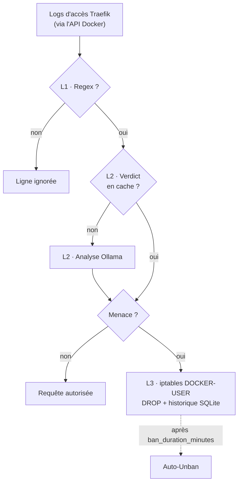

# docker-ban-daemon (`dockban`)

> **Démon de détection d'intrusion et de bannissement IP en Go pour environnements Docker.** Il surveille les logs d'accès d'un reverse proxy conteneurisé, évalue les requêtes suspectes via un LLM local (Ollama), bloque les IP malveillantes au niveau noyau (`iptables`) et expose une API de contrôle.


## Sommaire

- [Présentation](#présentation)
- [Fonctionnalités](#fonctionnalités)
- [Fonctionnement](#fonctionnement)
- [Prérequis](#prérequis)
- [Installation](#installation)
- [Configuration](#configuration)
- [Utilisation](#utilisation)
- [Environnement de test](#environnement-de-test)
- [Sécurité et limites](#sécurité-et-limites)
- [Contenu du dépôt](#contenu-du-dépôt)

## Présentation

`dockban` s'exécute en tant que service `systemd` sur un hôte Docker. Il consomme en continu les logs d'accès d'un conteneur cible (typiquement **Traefik**), filtre les motifs d'attaque web (injection SQL, injection de commandes, path traversal), sollicite un **LLM local (Ollama)** sur les cas suspects, puis bloque l'adresse IP source via **iptables**. Le bannissement expire automatiquement après une durée configurable.

L'architecture repose sur un pipeline en trois couches :

| Couche | Rôle |
|---|---|
| **L1 — Filtrage** | Expression régulière appliquée à chaque ligne de log. |
| **L2 — Analyse IA** | Déduplication par cache SHA-256, puis classification par le LLM (Ollama). |
| **L3 — Remédiation** | Insertion d'une règle `DROP` dans la chaîne iptables `DOCKER-USER`, avec levée automatique (TTL). |

Par défaut, l'inférence IA reste entièrement locale (Ollama sur `localhost`).

## Fonctionnalités

- **Multi-tenancy :** configuration isolée par instance/client via un fichier JSON.
- **Filtrage L1 :** expression régulière configurable appliquée en continu au flux de logs du conteneur ciblé.
- **Classification IA L2 :** verdict `MENACE` / `SAIN` produit par un modèle local (`llama3.2` par défaut).
- **Cache SHA-256 :** déduplication des requêtes analysées ; un motif déjà évalué est tranché sans solliciter le modèle (latence quasi nulle).
- **Blocage réseau L3 :** blocage dynamique au niveau noyau (`iptables`, chaîne `DOCKER-USER`) avec expiration automatique (Auto-Unban).
- **Persistance des événements :** journalisation de chaque blocage dans une base SQLite.
- **API de contrôle :** endpoints `/api/metrics` (statistiques et derniers événements) et `/api/unban`, protégés par clé d'API.
- **Liste blanche :** exclusion des adresses IP de confiance du mécanisme de bannissement.
- **Intégration systemd :** démarrage automatique et redémarrage en cas de défaillance.

## Fonctionnement



1. **Collecte :** le démon suit les flux `stdout` et `stderr` du conteneur `target_container` via l'API Docker. Seules les nouvelles lignes sont traitées. Il attend le format d'access log par défaut de Traefik (CLF) : la première colonne correspond à l'IP client, la requête HTTP est délimitée par des guillemets.
2. **L1 — Regex :** chaque ligne est comparée à `regex_pattern`. Les adresses présentes dans `whitelisted_ips` sont ignorées.
3. **L2 — Cache :** la requête HTTP (extraite entre les premiers guillemets) est hachée en SHA-256. Si un verdict existe en mémoire, il est appliqué immédiatement.
4. **L2 — LLM :** en l'absence d'entrée en cache, Ollama évalue la requête (température `0`, 5 tokens maximum) et répond `MENACE` ou `SAIN`. Le résultat est mis en cache.
5. **Politique fail-closed :** si Ollama est injoignable ou dépasse le timeout d'**1 seconde**, la requête est classée comme malveillante (moteur `Heuristique L2`). Toute réponse vide ou ne contenant pas le mot `SAIN` est également traitée comme une menace.
6. **L3 — Bannissement :** exécution de `iptables -I DOCKER-USER 1 -s <ip> -j DROP`, enregistrement dans SQLite et programmation de la levée du ban après `ban_duration_minutes`.

## Prérequis

| Composant | Remarque |
|---|---|
| Linux + systemd | privilèges `root` ; binaire `iptables` dans le `PATH` |
| Docker Engine | fournit la chaîne `DOCKER-USER` ; le service dépend de `docker.service` |
| Docker Compose v2 | uniquement pour l'[environnement de test](#environnement-de-test) |
| Go 1.26 ou supérieur | compilation du binaire |
| Compilateur C (`gcc`) | requis par `go-sqlite3` (`CGO_ENABLED=1`) |
| [Ollama](https://ollama.com) | avec le modèle configuré, ex. `ollama pull llama3.2` |

## Installation

```bash
git clone https://github.com/snisharahamad/docker-ban-daemon.git
cd docker-ban-daemon

# 1. Compiler et installer le binaire (CGO requis pour go-sqlite3)
#    Debian/Ubuntu : sudo apt install build-essential
(cd agent-go && CGO_ENABLED=1 go build -o dockban .)
sudo install -m 0755 agent-go/dockban /usr/local/bin/dockban

# 2. Créer la configuration (voir la section Configuration)
sudo mkdir -p /etc/dockban /var/lib/dockban
sudo cp config_example.json /etc/dockban/config.json
sudo nano /etc/dockban/config.json      # renseigner api_key et db_path
sudo chmod 600 /etc/dockban/config.json

# 3. Installer et démarrer le service systemd
sudo cp dockban.service /etc/systemd/system/dockban.service
sudo systemctl daemon-reload
sudo systemctl enable --now dockban
```

## Configuration

Le démon lit sa configuration dans **`/etc/dockban/config.json`** (chemin fixe). Un fichier dédié est utilisé par client (multi-tenancy).

```json
{
  "client_name": "NOM_DU_CLIENT",
  "target_container": "traefik-proxy",
  "ollama_url": "http://localhost:11434/api/generate",
  "llm_model": "llama3.2",
  "discord_webhook": "URL_WEBHOOK_ICI",
  "ban_duration_minutes": 60,
  "metrics_port": "127.0.0.1:9090",
  "api_key": "GENERER_UNE_CLE_LONGUE_ET_ALEATOIRE",
  "db_path": "/var/lib/dockban/dockban.db",
  "whitelisted_ips": ["127.0.0.1"],
  "regex_pattern": "(?i)(union\\s+select|[;&|]|%3B|%26|%7C)\\s*(id|whoami|wget|curl|cat)|(\\/|%2F)etc(\\/|%2F)passwd|(\\.\\.%2F|\\.\\.\\/)"
}
```

| Clé | Description |
|---|---|
| `client_name` | Identifiant du tenant, repris dans les logs et dans la réponse de `/api/metrics`. |
| `target_container` | Nom du conteneur Docker surveillé (ex. `traefik-proxy`). |
| `ollama_url` | Endpoint `generate` de l'API Ollama. |
| `llm_model` | Modèle Ollama utilisé pour la classification. |
| `discord_webhook` | Champ réservé (non utilisé dans cette version). |
| `ban_duration_minutes` | Durée d'un ban en minutes (`0` = pas d'expiration automatique). |
| `metrics_port` | Adresse d'écoute (`hôte:port`) de l'API de contrôle. |
| `api_key` | Clé d'authentification de l'API de contrôle. **Obligatoire et non vide.** |
| `db_path` | Chemin de la base SQLite. Le répertoire parent doit exister. |
| `whitelisted_ips` | Liste des adresses IP exclues du bannissement. |
| `regex_pattern` | Expression régulière (syntaxe Go) appliquée à chaque ligne de log. |

> ⚠️ **`api_key` ne doit jamais être vide.** Si la clé est absente ou vide dans le JSON, l'API de contrôle accepte les requêtes sans authentification. Générez une clé robuste via `openssl rand -hex 32`.

> **Remarque :** dans le JSON, chaque `\` de l'expression régulière doit être échappé (`\\s`). Le motif d'exemple s'applique à la ligne de log entière et peut correspondre à des requêtes légitimes contenant `&id=` ou `&cat=`. Adaptez-le à votre trafic réel.

## Utilisation

```bash
sudo systemctl status dockban          # état du service
sudo journalctl -u dockban -f          # logs en temps réel
sudo iptables -L DOCKER-USER -n        # adresses IP actuellement bannies
sudo systemctl restart dockban         # recharger après modification de la configuration
```

Marqueurs dans les logs : `[L1 REGEX]` (requête suspecte), `[CACHE HIT L2]` (verdict en cache), `[FALLBACK L2]` (Ollama indisponible ou timeout), `[L3 BAN]` et `[UNBAN]`.

### API de contrôle

L'API écoute sur `metrics_port` et requiert la clé d'API dans l'en-tête `Authorization`.

```bash
KEY="votre_api_key"

# Statistiques et 50 derniers événements
curl -H "Authorization: Bearer $KEY" http://127.0.0.1:9090/api/metrics

# Débannir une IP manuellement
curl -H "Authorization: Bearer $KEY" "http://127.0.0.1:9090/api/unban?ip=203.0.113.7"
```

Exemple de réponse de `/api/metrics` (données fictives) :

```json
{
  "client": "NOM_DU_CLIENT",
  "status": "OPERATIONAL",
  "metrics": {
    "logs_processed": 1240,
    "regex_hits": 3,
    "cache_hits": 1,
    "llm_calls": 2,
    "active_bans": 1
  },
  "events": [
    {
      "id": 1,
      "timestamp": "2026-11-17T21:04:12Z",
      "ip": "203.0.113.7",
      "uri": "GET /ping?ip=127.0.0.1;id HTTP/1.1",
      "engine": "Llama 3.2",
      "active": true
    }
  ]
}
```

- `logs_processed` : lignes analysées · `regex_hits` : détections L1 · `cache_hits` : verdicts servis depuis le cache · `llm_calls` : appels effectués vers Ollama · `active_bans` : règles de blocage actives.
- `engine` précise la source de la décision : `Llama 3.2`, `Cache SHA-256` ou `Heuristique L2` (fallback).

## Environnement de test

Le fichier `docker-compose.yml` déploie un laboratoire isolé sur le réseau `dockban-net` :

| Service | Rôle |
|---|---|
| `traefik` (`traefik-proxy`) | Reverse proxy Traefik v2.11, access logs activés, ports `80` et `8080`. Conteneur surveillé par le démon. |
| `vulnerable-api` | Application Flask (`target/server.py`) servie par gunicorn, routée par Traefik sur `api.dockban.local`. |

```bash
docker compose up -d
```

Au premier démarrage, `vulnerable-api` installe Flask et gunicorn (accès Internet requis).

> ⚠️ **Environnement de test uniquement.** `server.py` est volontairement vulnérable (injection de commandes via `os.popen`, XSS réfléchi) et le dashboard Traefik est exposé sans authentification (`--api.insecure=true`, port `8080`). Ne déployez jamais ce lab sur un réseau public.

Pour tester un blocage réel, envoyez une requête depuis **une machine distincte** (depuis l'hôte lui-même, Traefik voit généralement l'IP de la passerelle Docker plutôt que `127.0.0.1`, ce qui fausse le test) :

```bash
echo "IP_DU_LAB api.dockban.local" | sudo tee -a /etc/hosts
curl "http://api.dockban.local/ping?ip=127.0.0.1;id"
```

Vérifiez ensuite les logs (`[L1 REGEX]` puis `[L3 BAN]`), la règle ajoutée dans `iptables -L DOCKER-USER -n` et l'événement dans `/api/metrics`. La règle est supprimée automatiquement après `ban_duration_minutes` (`[UNBAN]`).

## Sécurité et limites

### Bonnes pratiques

- **Privilèges :** le service tourne sous `User=root` pour administrer `iptables` et accéder à la socket Docker. Restreignez les droits d'écriture sur `/usr/local/bin/dockban` et `/etc/dockban/`.
- **Clé d'API :** utilisez une valeur longue et aléatoire, ne versionnez jamais votre `config.json` de production et privilégiez l'en-tête `Authorization` au paramètre `?token=` (qui laisse des traces dans les logs et historiques).
- **Exposition de l'API :** l'interface d'administration écoute sur `127.0.0.1` par défaut. Ne l'exposez pas sur Internet.
- **Liste blanche :** ajoutez vos IP d'administration dans `whitelisted_ips` pour éviter tout auto-bannissement.
- **Cadre d'usage :** cet outil est conçu pour protéger vos propres infrastructures. N'exécutez les tests d'intrusion que sur des systèmes qui vous appartiennent.

### Limites connues

- **Fail-closed et timeout d'1 s :** si Ollama dépasse 1 seconde de latence (démarrage à froid, CPU contraint), l'IP est bannie par l'heuristique. Préchargez le modèle (`curl http://localhost:11434/api/generate -d '{"model":"llama3.2"}'`), maintenez-le en mémoire (`OLLAMA_KEEP_ALIVE=-1`) et privilégiez une accélération GPU.
- **État en mémoire et nettoyage `DOCKER-USER` :** le cache de verdicts et la table des bans actifs ne sont pas persistés (ni bornés en taille). Au démarrage et à l'arrêt, le démon réinitialise la chaîne `DOCKER-USER` (`iptables -F`, puis règle `RETURN`) : les bans en cours ne survivent pas à un redémarrage et toute règle personnalisée dans cette chaîne est effacée.
- **Extraction de l'IP :** l'IP bannie est lue dans la première colonne du log. Derrière un CDN ou un reverse proxy amont, assurez-vous que Traefik journalise bien l'IP réelle du client.
- **Regex d'exemple :** elle peut générer des faux positifs (`&id=`, `&cat=`), et `union select` n'est détecté que s'il est suivi de `id`, `whoami`, `wget`, `curl` ou `cat`.
- **Prompt injection :** la requête HTTP brute est injectée dans le prompt envoyé au LLM ; un attaquant peut tenter de manipuler la classification.

## Contenu du dépôt

| Chemin | Rôle |
|---|---|
| `agent-go/main.go` | Code source du démon : collecte des logs, filtrage, appels Ollama, gestion iptables, API HTTP |
| `agent-go/go.mod`, `agent-go/go.sum` | Définition du module Go et dépendances |
| `config_example.json` | Modèle de configuration à copier vers `/etc/dockban/config.json` |
| `dockban.service` | Fichier d'unité `systemd` |
| `docker-compose.yml` | Environnement de test (Traefik + API vulnérable) |
| `target/server.py` | Application Flask volontairement vulnérable pour les tests |

Dépendances Go directes : [`docker/docker`](https://github.com/moby/moby) (client de l'API Docker) et [`mattn/go-sqlite3`](https://github.com/mattn/go-sqlite3) (driver SQLite via CGO).

---

Projet développé par [@snisharahamad](https://github.com/snisharahamad).